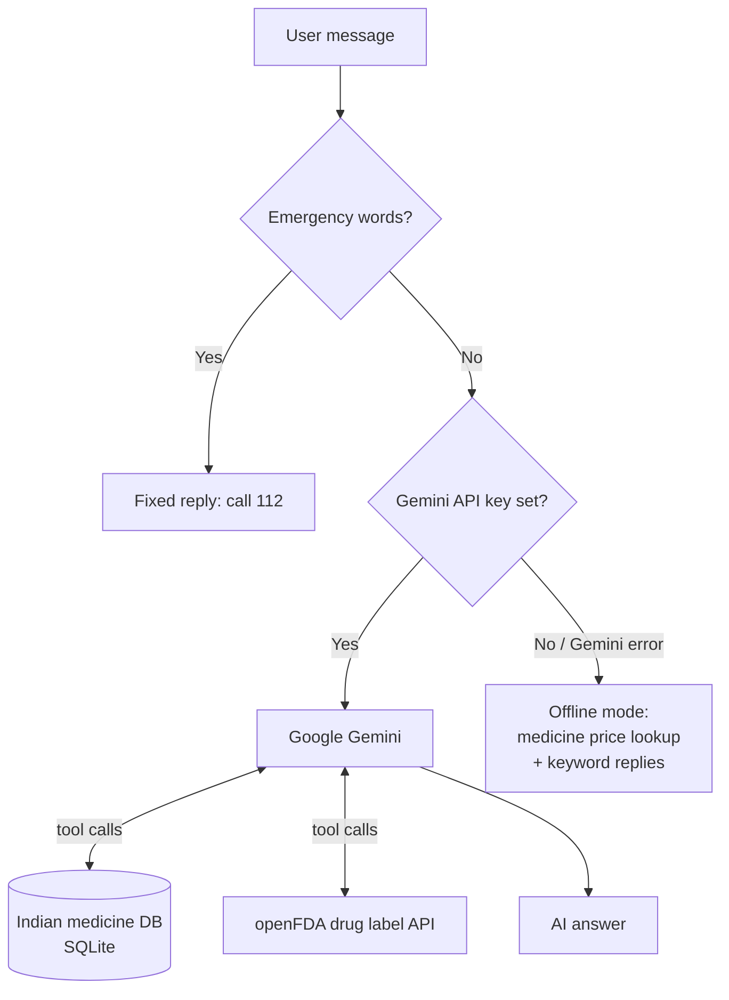

# 🏥 GoviCare AI
### AI Healthcare Assistant for India

GoviCare AI is a healthcare information web app built with Python and Streamlit. Its chatbot is powered by **Google Gemini** and understands English, Hindi and Hinglish. It is connected to a database of about **2.5 lakh medicines sold in India**, so it can answer questions about medicine prices, compositions, cheaper alternatives and side effects. The app also has a symptom checker, first-aid guides, diet information and 12 health calculators and trackers.

> ⚠️ Educational project. It does not diagnose or prescribe. In an emergency, call **112**.

---

## 🚀 Features

### 🤖 AI Healthcare Chatbot
- Natural conversation in **English, Hindi or Hinglish**, powered by Google Gemini.
- Remembers the conversation, so follow-up questions work.
- Uses **tools** while answering: Gemini decides when to search Indian medicines, find cheaper alternatives or fetch drug safety information.
- **Emergency safety:** messages about chest pain, breathing trouble, stroke signs and similar always get a fixed "call 112" reply. This never depends on the AI or the internet.
- **Works without an API key** too. It falls back to keyword-based replies and an offline medicine price lookup.
- Chat history is saved in SQLite.

### 💊 Indian Medicine Search
- Search about **2.5 lakh Indian brands** by brand name (e.g. *Dolo 650*) or salt (e.g. *pantoprazole*).
- See the ₹ price, manufacturer, pack size and composition.
- **💰 Cheaper alternatives:** other brands with the exact same composition and strength, sorted by price.
- **🛡️ Safety information:** uses, warnings, side effects, interactions and pregnancy advice from U.S. FDA drug labels (openFDA). Indian salt names are converted to U.S. names first, e.g. Paracetamol → acetaminophen.

### 🩺 More Health Modules
- **Symptom Checker:** general guidance for selected symptoms.
- **First Aid Guide:** steps for common situations.
- **Diet & Nutrition:** balanced diet and nutrition information.
- **Health Information:** educational articles on common topics.

### 🛠️ 12 Health Tools
BMI calculator · Water intake · Calorie calculator · BMR calculator · Medicine reminder · Health tracker · Blood pressure tracker · Heart rate tracker · Sleep calculator · Step & activity tracker · Nutrition calculator · Stress & wellness tracker

---

## 🧠 How the Chatbot Works



The page header shows which mode is active: 🟢 **AI mode** (Gemini) or 🟡 **Basic mode** (no key).

### Data sources

| Data | Source | Notes |
|---|---|---|
| Indian brands, prices, compositions | [Indian Medicine Dataset](https://github.com/junioralive/Indian-Medicine-Dataset) (MIT) | Downloaded once into a local SQLite DB. Prices may be out of date. |
| Side effects, warnings, interactions | [openFDA drug label API](https://open.fda.gov/apis/drug/label/) | Free, no key needed. U.S. labels; Indian labelling may differ. |
| AI answers | [Google Gemini API](https://ai.google.dev/) | Free tier available. |

**Why not an Indian drug API?** India has no free public drug API yet. The government's National Drug Registry has not published open endpoints, so this project combines an Indian brand dataset with FDA safety data, linked by the generic salt name.

---

## 💬 Try These Questions

| Question | What it shows |
|---|---|
| `dolo 650 ki kimat batao` | Indian brand price lookup (works even without a key) |
| `Is there a cheaper alternative to Pan 40?` | Same-composition brands, cheapest first |
| `What are the side effects of cetirizine?` | FDA safety data |
| `Mujhe 2 din se bukhar hai, kya karun?` | Hinglish conversation |
| `Can I take paracetamol during pregnancy?` | Safety info with a "consult your doctor" note |
| `I have chest pain` | Fixed emergency reply |

---

## ⚙️ Installation & Setup

**Requirements:** Python 3.10 or newer.

### 1. Get the code and install dependencies

```bash
cd AI_healthcare_chatbot
python -m venv .venv
.venv\Scripts\activate          # Windows  (macOS/Linux: source .venv/bin/activate)
pip install -r requirements.txt
```

### 2. Download the medicine database (one time, ~30 MB)

```bash
python setup_data.py
```

If you skip this step, the app downloads it automatically the first time you open Medicine Information.

### 3. Add your Gemini API key (optional but recommended)

Get a free key at <https://aistudio.google.com/apikey>, then:

```bash
copy .env.example .env          # macOS/Linux: cp .env.example .env
```

Open `.env` and paste the key after `GEMINI_API_KEY=`. You can also set `GEMINI_MODEL` to use a different Gemini model (default: `gemini-3.6-flash`).

### 4. Run the app

```bash
streamlit run app.py
```

The app opens at <http://localhost:8501>.

---

## 📂 Project Structure

```text
AI_healthcare_chatbot/
│
├── app.py              # Streamlit UI: dashboard, chatbot, medicine search, tools
├── chatbot.py          # Reply routing: emergency → Gemini → offline fallback
├── gemini_bot.py       # Gemini client, system prompt and tool functions
├── medicine_data.py    # Indian medicine DB: download, search, alternatives
├── openfda.py          # openFDA drug label lookup + Indian→U.S. name mapping
├── database.py         # SQLite chat history
├── setup_data.py       # One-time medicine dataset download
├── requirements.txt
├── .env.example        # Template for your Gemini API key
├── README.md
│
├── data/medicines.db   # Created by setup_data.py (not committed)
└── healthcare.db       # Chat history (not committed)
```

---

## 💻 Technologies Used

- **Python**, **Streamlit**: web app
- **Google Gemini API** (`google-genai`): AI chat with function calling
- **openFDA API**: drug safety labels
- **SQLite**: medicine database and chat history
- **Pandas**, **NumPy**, **Requests**, **python-dotenv**

---

## 🔮 Future Improvements

- Voice input and replies in regional languages.
- Nearby hospital and Jan Aushadhi Kendra finder.
- Prescription image reading (OCR) to identify medicines.
- User accounts with personal health records.
- Live Indian drug data once the National Drug Registry opens its APIs.

---

## ⚠️ Disclaimer

This is an educational project made for learning and demonstration. It does not provide medical diagnosis, treatment or professional medical advice. Medicine prices may be out of date, and safety information comes from U.S. FDA labels, which may differ from Indian labelling. Always consult a qualified doctor or pharmacist. **In an emergency, call 112.**

---

## 🙏 Credits

- Indian medicine data: [junioralive/Indian-Medicine-Dataset](https://github.com/junioralive/Indian-Medicine-Dataset) (MIT License)
- Drug label data: [openFDA](https://open.fda.gov/), U.S. Food and Drug Administration

## 👨‍💻 Developer

**Govind Pandey**

MCA Project | Python Developer

### ❤️ GoviCare AI
*Smart Healthcare. Smarter Living.*
